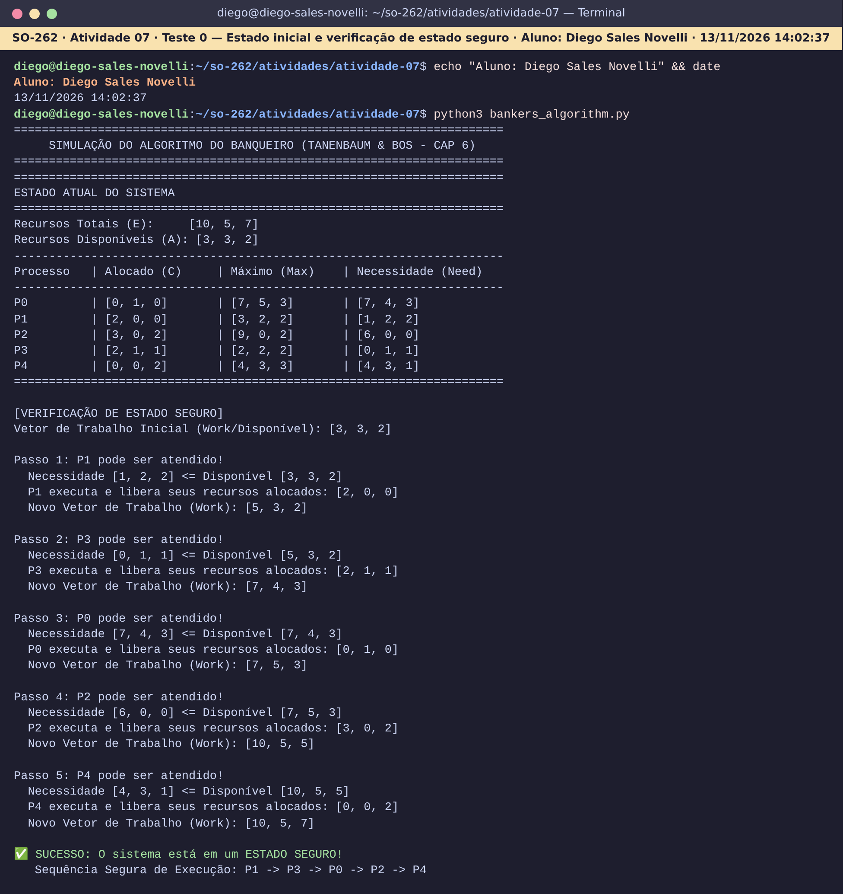
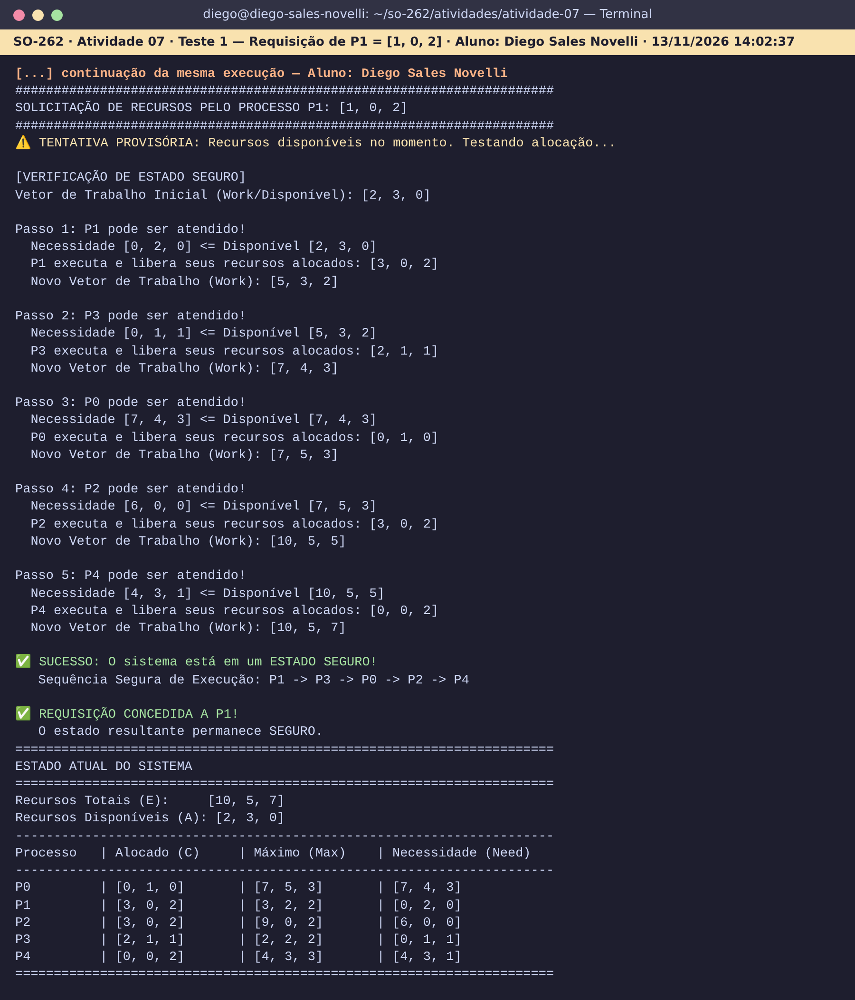
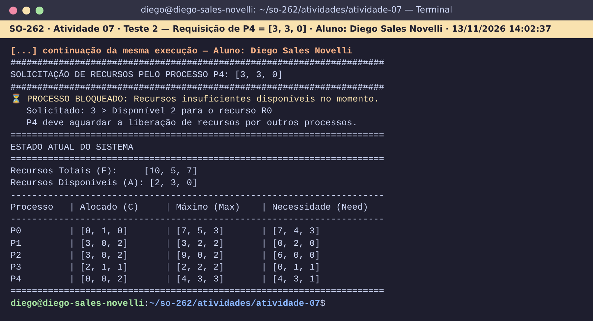

# Atividade 07 — Algoritmo do Banqueiro

**Aluno:** Diego Sales Novelli
**Disciplina:** Sistemas Operacionais (SO-262)

## Enunciado

> Execute o algoritmo dos Banqueiros definido na aula anterior.
> Gere arquivos que evidenciam a execução no GitHub na pasta atividade-07 como definido abaixo:
> 1) Explicando cada teste proposto e sua saída gerada;
> 2) Print da execução de cada Teste.
> 3) Identifique o seu nome nos prints.

## Arquivos desta pasta

| Arquivo | Conteúdo |
|---|---|
| `bankers_algorithm.py` | Código do simulador do Algoritmo do Banqueiro usado na aula |
| `saida_execucao.txt` | Saída completa (texto) da execução `python3 bankers_algorithm.py` |
| `prints/teste-00-estado-inicial.png` | Print do Teste 0 — estado inicial e verificação de segurança |
| `prints/teste-01-requisicao-p1.png` | Print do Teste 1 — requisição de P1 |
| `prints/teste-02-requisicao-p4.png` | Print do Teste 2 — requisição de P4 |

Para executar:

```bash
python3 bankers_algorithm.py
```

## Como o algoritmo funciona (resumo)

O Algoritmo do Banqueiro (Dijkstra) só concede uma requisição se o sistema continuar em
**estado seguro**, ou seja, se ainda existir pelo menos uma ordem em que todos os processos
conseguem terminar. Estruturas usadas pelo simulador:

- **E (Existing)** — total de cada recurso no sistema.
- **C (Current / Allocation)** — o que cada processo já tem alocado.
- **Max** — o máximo que cada processo declarou que pode pedir.
- **Need = Max − C** — o que cada processo ainda pode pedir.
- **A (Available) = E − soma das colunas de C** — o que está livre agora.

**Verificação de estado seguro:** começa com `Work = A`. Procura um processo ainda não
finalizado cujo `Need ≤ Work`; se achar, supõe que ele termina e devolve o que tem
(`Work = Work + C[i]`). Repete até finalizar todos (estado **seguro**) ou até não haver
candidato (estado **inseguro**).

**Tratamento de uma requisição `Request` do processo Pi:**
1. Se `Request > Need[i]` → erro, o processo pediu mais do que declarou.
2. Se `Request > A` → o processo é **bloqueado** e espera (não há recursos livres agora).
3. Faz uma alocação **provisória**: `A = A − Request`, `C[i] = C[i] + Request`, `Need[i] = Need[i] − Request`.
4. Roda a verificação de segurança: se o novo estado for seguro, **concede**; se não, faz **rollback** e o processo espera.

## Dados de entrada

5 processos (P0 a P4) e 3 tipos de recurso (R0, R1, R2), com E = [10, 5, 7].

| Processo | Alocado (C) | Máximo (Max) | Necessidade (Need) |
|---|---|---|---|
| P0 | [0, 1, 0] | [7, 5, 3] | [7, 4, 3] |
| P1 | [2, 0, 0] | [3, 2, 2] | [1, 2, 2] |
| P2 | [3, 0, 2] | [9, 0, 2] | [6, 0, 0] |
| P3 | [2, 1, 1] | [2, 2, 2] | [0, 1, 1] |
| P4 | [0, 0, 2] | [4, 3, 3] | [4, 3, 1] |

Soma das colunas de C = [7, 2, 5], então A = [10, 5, 7] − [7, 2, 5] = **[3, 3, 2]**.

---

## Teste 0 — Estado inicial e verificação de estado seguro

**O que testa:** se o estado inicial do sistema já é seguro, antes de qualquer requisição.

**Saída gerada (passo a passo):**

| Passo | Processo escolhido | Need ≤ Work? | Recursos devolvidos | Novo Work |
|---|---|---|---|---|
| — | — | — | — | [3, 3, 2] |
| 1 | P1 | [1, 2, 2] ≤ [3, 3, 2] ✔ | [2, 0, 0] | [5, 3, 2] |
| 2 | P3 | [0, 1, 1] ≤ [5, 3, 2] ✔ | [2, 1, 1] | [7, 4, 3] |
| 3 | P0 | [7, 4, 3] ≤ [7, 4, 3] ✔ | [0, 1, 0] | [7, 5, 3] |
| 4 | P2 | [6, 0, 0] ≤ [7, 5, 3] ✔ | [3, 0, 2] | [10, 5, 5] |
| 5 | P4 | [4, 3, 1] ≤ [10, 5, 5] ✔ | [0, 0, 2] | [10, 5, 7] |

**Resultado:** ✅ estado **SEGURO**, com sequência segura **P1 → P3 → P0 → P2 → P4**.

Observações:
- Na primeira volta, P0 não pode ser escolhido porque Need = [7, 4, 3] é maior que Work = [3, 3, 2]. O algoritmo pula para P1, que cabe.
- Depois de cada processo atendido, a busca recomeça do P0 — por isso P0 entra no passo 3, quando Work chega a [7, 4, 3].
- No final, Work = [10, 5, 7] = E: todos os recursos voltaram, o que confirma que as contas fecham.



---

## Teste 1 — Requisição de P1 = [1, 0, 2] (requisição válida e segura)

**O que testa:** o caminho em que a requisição passa por todas as verificações e é concedida.

**Saída gerada:**
1. `Request ≤ Need[P1]`? [1, 0, 2] ≤ [1, 2, 2] ✔
2. `Request ≤ A`? [1, 0, 2] ≤ [3, 3, 2] ✔
3. Alocação provisória:
   - A = [3, 3, 2] − [1, 0, 2] = **[2, 3, 0]**
   - C[P1] = [2, 0, 0] + [1, 0, 2] = **[3, 0, 2]**
   - Need[P1] = [1, 2, 2] − [1, 0, 2] = **[0, 2, 0]**
4. Verificação de segurança a partir de Work = [2, 3, 0]:
   - P1: [0, 2, 0] ≤ [2, 3, 0] ✔ → Work = [5, 3, 2]
   - P3: [0, 1, 1] ≤ [5, 3, 2] ✔ → Work = [7, 4, 3]
   - P0: [7, 4, 3] ≤ [7, 4, 3] ✔ → Work = [7, 5, 3]
   - P2: [6, 0, 0] ≤ [7, 5, 3] ✔ → Work = [10, 5, 5]
   - P4: [4, 3, 1] ≤ [10, 5, 5] ✔ → Work = [10, 5, 7]

**Resultado:** ✅ **REQUISIÇÃO CONCEDIDA A P1** — o estado resultante continua seguro
(sequência P1 → P3 → P0 → P2 → P4). A tabela exibida depois mostra o novo estado:
A = [2, 3, 0], P1 com C = [3, 0, 2] e Need = [0, 2, 0].

Repare que, mesmo com R2 zerado (A = [2, 3, 0]), o estado é seguro: P1 já pode terminar
pedindo só [0, 2, 0], e ao terminar devolve os recursos que destravam os demais.



---

## Teste 2 — Requisição de P4 = [3, 3, 0]

**O que testa:** uma requisição feita sobre o estado deixado pelo Teste 1 (A = [2, 3, 0]).
O comentário no código diz "Excede disponível ou gera estado inseguro"; na execução,
o que acontece é o primeiro caso.

**Saída gerada:**
1. `Request ≤ Need[P4]`? [3, 3, 0] ≤ [4, 3, 1] ✔ — P4 não pediu mais do que declarou.
2. `Request ≤ A`? [3, 3, 0] ≤ [2, 3, 0] ✘ — no recurso **R0**, pediu 3 mas só há 2 livres.

**Resultado:** ⏳ **PROCESSO BLOQUEADO** — P4 precisa esperar outros processos liberarem
recursos. Como a requisição parou no passo 2, **não houve alocação provisória nem
verificação de segurança**, e por isso não houve rollback. A tabela exibida depois é
idêntica à do final do Teste 1: o estado do sistema não mudou.

Diferença importante entre os dois tipos de recusa no algoritmo:
- **Bloqueio por falta de recurso (este teste):** não há recursos livres agora; nem dá para testar.
- **Negação por estado inseguro:** os recursos até existem, mas entregá-los levaria a um estado sem sequência segura (risco de deadlock). Nesse caso o simulador faz a alocação provisória, detecta o estado inseguro e faz rollback.



---

## Conclusão

| Teste | Requisição | Verificações | Resultado |
|---|---|---|---|
| 0 | — (estado inicial) | Segurança | ✅ Seguro: P1 → P3 → P0 → P2 → P4 |
| 1 | P1 pede [1, 0, 2] | Need ✔, Available ✔, Segurança ✔ | ✅ Concedida |
| 2 | P4 pede [3, 3, 0] | Need ✔, Available ✘ (R0: 3 > 2) | ⏳ Bloqueado, estado inalterado |

Os testes mostram que o Algoritmo do Banqueiro evita deadlocks **antes** que eles aconteçam:
cada pedido só é atendido se o sistema continuar com pelo menos uma ordem de execução em
que todos os processos terminam.
